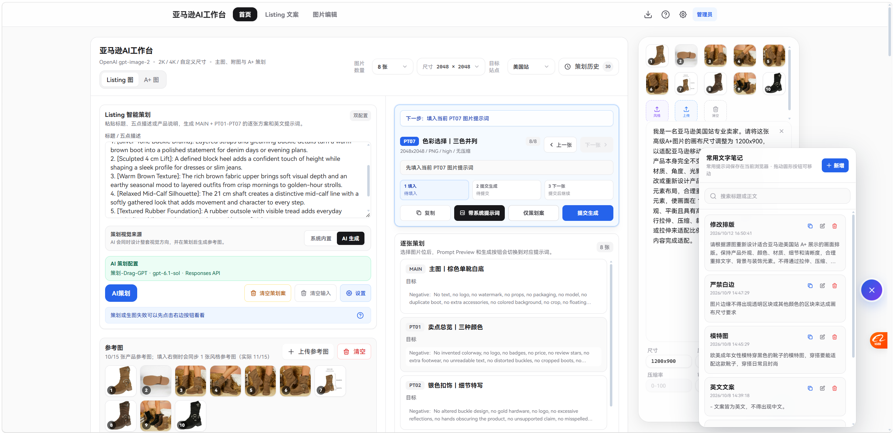
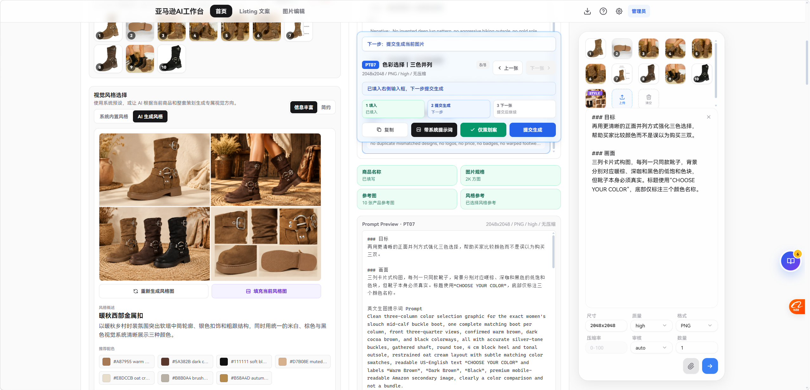
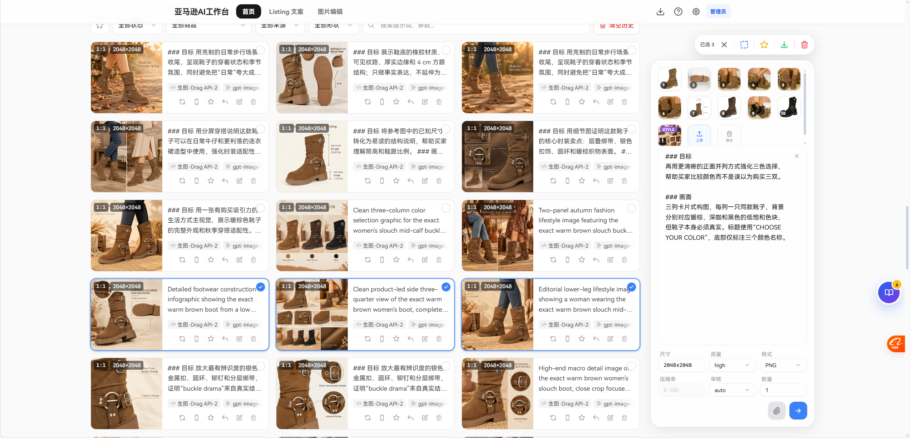
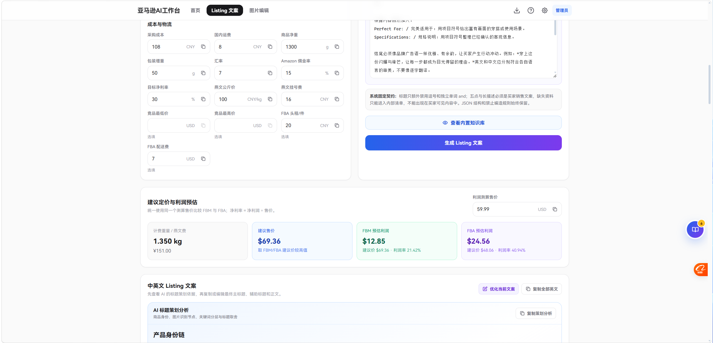
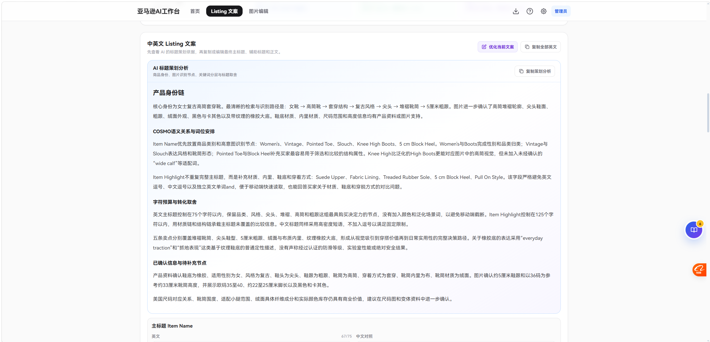

# 亚马逊AI工作台

本分支包含统一设置、用户账户、管理员配置分配与可选本站代理；线上体验站可能仍运行其他版本。本次修改不会自动创建 Git 标签或发布线上版本。

面向 Amazon Listing 与 A+ Content 的 AI 文案、图片策划和生成工作台。输入商品信息与参考图，即可生成中英文 Listing 文案、利润建议、分镜方案、提示词并逐张出图。

[🌐 作者博客](https://meochun.fun) · [🐛 反馈问题](https://github.com/KnightKilito/amazon-image-studio/issues) · [📝 更新日志](#-更新日志) · [✒️ 体验地址](https://amzpic.moechun.fun/)

> 源码不内置模型 Key 或免费额度。纯前端模式使用自己的 API；平台模式可使用管理员分配的直连配置、自定义直连或“本站”配置。三者的连接与计费来源不同，使用前请确认所选配置。

## ✨ 功能

- 🪶 Listing 图片策划：默认 `MAIN + PT01-PT06`，可自定义为 `7-12` 张。
- 📝 Listing 文案：生成美国站 Item Name、Item Highlight、五点、长描述、关键词与中文对照，并测算 FBM/FBA 利润。
- ✒️ A+ 图片策划：支持普通、标准、高级、手机 A+ 与独立品牌故事；高级 A+ 的独立模块和自由编排均可同步策划 From the brand。
- 🖼️ 图片编辑：支持 AI 编辑、输入主图切换、局部遮罩、A+ 母图切割、本地等比放大和高级/手机 A+ 转换准备。
- 💾 参考图、遮罩编辑、视觉风格、历史记录、批量下载与本地 IndexedDB 存储。
- 🧠 支持 OpenAI / OpenAI 兼容接口、OpenRouter，以及独立的 Chat Completions / Responses 策划配置。
- 📒 内置 Amazon 主图、附图与 A+ 尺寸规则；生成时会带入目标分辨率与合规约束。

**可选平台模式**：用户登录后自动加载管理员分配的个人直连配置，也可明确选择本站钱包代理。默认直连、不占本站图片转发带宽；直连额度与本站钱包分开。第一期人工充值，不含在线支付。

## 📚 先按身份选择教程

| 你要做什么 | 从这里开始 |
| --- | --- |
| 普通用户登录、选择配置、开始策划生图 | [普通用户使用教程](src/docs/07-account-routing.md)；站内“使用文档 → 用户入门” |
| 管理员创建用户、分配配置、恢复细分权限、批量换站 | [管理员手册](docs/admin-guide.md)；管理员登录后的“使用文档 → 管理员手册” |
| 本地 Docker 启动／部署到云服务器 | 管理员手册第 02／03 节 |
| 学习 Listing、A+、图片编辑和本地数据操作 | [Listing 图](src/docs/01-listing.md)、[A+](src/docs/02-premium-aplus.md)、[Listing 文案](src/docs/05-listing-copy.md)、[图片编辑](src/docs/06-image-editor.md)、[基础操作](src/docs/03-operations.md) |

普通用户无需进入 New API 管理端。当前平台账户由管理员创建，尚未开放自助注册、支付宝／微信在线充值和实际广告投放；不要把预留的入口能力当作已上线服务。

## 📸 截图

<!-- 截图预留：上传后将图片放至 docs/screenshots/，并取消对应 img 标签的注释。 -->

<p align="center">
  
</p>
<p align="center">
  
</p>
<p align="center">
  
</p>
<p align="center">
  
</p>
<p align="center">
  
</p>


## 🚀 快速开始

### 方式 A：纯前端，自带 API

适合个人使用或只开发前端，不需要运行 New API，也不要求平台登录。宿主机需要 Node.js 20+、npm；若同时在宿主机运行平台后端，使用 Node.js 22.13+。

```powershell
npm ci
npm run dev
```

打开终端显示的地址，通常为 `http://127.0.0.1:5173/` 。Windows 也可双击 `start-amazon-image-studio.bat`；停止服务请按 `Ctrl + C`，或运行 `stop-amazon-image-studio.bat`。

此方式默认不启用 `VITE_PLATFORM_ENABLED`。若你要查看登录、钱包和管理员分配功能，使用下面的平台模式，不能只启动默认的 `npm run dev`。

### 方式 B：平台模式，使用本地 Docker

先启动 Docker Desktop，在项目根目录运行；宿主机不需要额外安装 Node、MySQL 或 Redis：

```powershell
powershell -NoProfile -ExecutionPolicy Bypass -File .\deploy\platform\init-env.ps1
docker compose --env-file deploy/platform/.env.local -f deploy/platform/compose.yml up -d --build
```

首次启动按顺序操作：

1. 打开 `http://localhost:3003` 初始化**自己的 New API** 管理员，并在其中创建普通用户。
2. 打开 `http://localhost:8091`，用同一管理员账户登录工作台。
3. 进入“设置 → 管理员设置”，在分页用户表格中搜索目标用户，点击“配置生图”／“配置策划”，填写个人有限额度 Key 后保存；“刷新列表与配置”可同步新用户及已保存配置。
4. 普通用户登录工作台，在“设置 → API 配置”中选中已分配配置即可使用，不需要到 New API 登录或充值。

过渡期可在“设置 → 账户与余额”修改自己的登录密码，直接同步 New API，成功后重新登录。管理员可关闭“允许在工作台修改密码（过渡期）”并保存站点设置，届时前后端同时禁用此入口；忘记密码仍需管理员重置。

脚本生成 `.env.local`，重复运行不会覆盖密钥。完整初始化、端口冲突、钱包换算和升级步骤见[管理员手册](docs/admin-guide.md)。带 `--build` 的命令用于本地电脑；小内存云服务器使用手册中的“本地构建、服务器加载运行”流程。

常用命令：

| 命令 | 用途 |
| --- | --- |
| `npm run dev` | 启动开发环境 |
| `npm run build` | 构建静态文件到 `dist/` |
| `npm run test` | 运行测试 |
| `npm run platform:server` | 启动 SQLite 平台后台（Node 22.13+，需配置 New API） |
| `npm run admin:server` | 平台后台启动命令的兼容别名 |
| `npm run test:platform` | 验证平台后端权限、会话、代理与存储 |

### 本地日志

开发服务（含 Windows 启动脚本）、预览、构建、管理员 API 和 Mock API 的终端输出会同时追加到根目录 `log/`：例如 `vite.out.log`、`vite.err.log`、`admin-server.out.log`。目录不存在时自动创建；npm 自身诊断日志放在 `log/npm/`（最多保留 10 份）。这些日志不提交 Git，也不打入 Docker 构建上下文，不影响浏览器中的图片和历史数据。

每次启动上述命令，还会将根目录遗留的 `.log` 文件归拢到 `log/`，重名文件保留两份，文件被占用时跳过并提示。IDE 的 Java/Git 辅助进程崩溃日志不受网站配置控制，可能临时出现在根目录，下次启动项目会再次收集。日志可能包含本地调试信息，分享前请检查敏感内容；长期运行可按需清理 `log/` 中不再需要的日志。

## 📖 使用流程

1. 平台用户先登录，在右上角“设置 → API 配置”分别选择“图片生成”和“AI 策划”配置；纯前端用户先填写自己的连接信息。管理员配置和本站配置不需要填写 URL、Key。
2. 进入 [`Listing 文案`](src/docs/05-listing-copy.md)，填写产品事实、成本和重量，按需上传参考图，生成并检查中英文文案、标题分析与建议定价。
3. 返回首页选择 `Listing 图` 或 `A+ 图`，粘贴已确认的文案并执行 AI 策划；高级 A+ 可选择独立模块、自由编排和是否同步策划 From the brand。
4. 在 [`图片编辑`](src/docs/06-image-editor.md) 中继续处理素材：可做 AI 局部编辑、遮罩、A+ 母图切割或本地等比放大。
5. 逐张提交生成；文案版本、图片结果和本地处理派生任务均保存在本地历史中，可恢复、筛选、复用、编辑或下载。

生图建议使用 `Images API (/v1/images)` 与 `gpt-image-2`。策划默认模型为 `gpt-6.1-sol`，可选择 `Chat Completions (/chat/completions)` 或 `Responses API (/v1/responses)`；实际可用性以你的中转站为准。默认值用于新建配置，不覆盖已保存的模型选择。DeepSeek 官方 Chat Completions 不接收参考图，应用会自动以纯文本请求策划。

### 三类配置与两种额度

| 配置来源 | 用户怎么操作 | 图片是否经过本站服务器 | 是否扣本站钱包 |
| --- | --- | --- | --- |
| 管理员配置 | 自动进入配置列表；可自选模型、高级选项，不能编辑连接字段 | 否，浏览器直连中转站 | 否，额度由上游个人 Key 控制 |
| 自定义直连 | 管理 → 新建配置 → 自定义直连，按权限填写自己的服务 | 否 | 否，使用自己的供应商额度 |
| 本站 | 管理 → 新建配置 → 走本站，再选中该配置 | 是 | 是，由自己的 New API 结算 |

选择配置即决定请求路径，不再另选“管理员／自己／代理”模式。没有配置或请求失败时，不会静默改走收费代理。本站余额在“设置 → 账户与余额”查看；直连 Key 的额度由中转站管理，本站不显示。人工充值时必须说明要充哪一种，不能重复记到两边。

管理员配置和本站配置允许手填模型及修改高级选项；推荐模型列表并不是授权清单，是否可用由实际服务／New API 用户权限决定。直连 Key 虽在界面和导出中隐藏，仍会用于浏览器请求，不能当作网络级保密。

## 🛠️ 管理与部署

### 服务器部署：两种方式

以下两种方式都提供完整平台（前端 + Node 后端 + 原版 New API）。**在本地构建，服务器只运行**，避免 2G 内存服务器执行 npm 构建卡死。只需要纯前端时，直接构建并发布 `dist/` 即可，不必部署后两个服务。

#### 先准备：部署密钥是什么、怎么生成？

这里的密钥是**自己随机生成的后台内部密钥，不是管理员密码，也不是中转站 API Key**，不需要购买或到中转站申请。纯前端模式不需要这两项。

| 配置项 | 用途 | 填到哪里 |
| --- | --- | --- |
| `STUDIO_ENCRYPTION_KEY` | 加密 Node 数据库中的用户直连 Key、会话凭据等敏感数据；必须是 32 个随机字节的 Base64 编码 | Node 后端环境变量；Docker 时填入部署 `.env` |
| `NEW_API_SESSION_SECRET` | 提供给 New API 的会话签名密钥 | Docker `.env` 使用此名称，Compose 自动传给 New API 的 `SESSION_SECRET`；手动部署直接使用 `SESSION_SECRET` |
| 中转站 API Key | 真正调用模型、由中转站计费 | 在管理员分配配置或 New API 渠道中填写，**不能拿它代替上面两把密钥** |

**推荐：Windows 本地自动生成。**在项目根目录运行，正式部署前把域名改成自己的：

```powershell
# 本地 Docker：生成 deploy/platform/.env.local
powershell -NoProfile -ExecutionPolicy Bypass -File .\deploy\platform\init-env.ps1
# 全新正式部署：生成独立的 deploy/platform/.env.production
powershell -NoProfile -ExecutionPolicy Bypass -File .\deploy\platform\init-env.ps1 -Origin https://studio.example.com -OutputPath .\deploy\platform\.env.production
```

两个命令分别用于本地和全新正式环境，不要求每次都运行。脚本会生成两把不同的安全随机密钥并写入文件，**不需要再手填密钥**；文件已存在时保持原样，不覆盖密钥或其他设置。正式部署把 `.env.production` 上传为服务器的 `deploy/platform/.env`，使用下文的 `--env-file` 启动。脚本不会替你配置真实钱包定价：收费前还须按管理员手册校准 `STUDIO_QUOTA_PER_CNY`。

**没有 PowerShell／采用手动部署时：**安装 Node.js 后，在可信的本地终端执行以下命令 **两次**，每次会生成不同的值：

```sh
node -e "console.log(require('node:crypto').randomBytes(32).toString('base64'))"
```

1. 将第一份输出完整复制到 Node 后端私有环境文件的 `STUDIO_ENCRYPTION_KEY=输出值`。
2. 将第二份输出填到 New API 私有环境文件的 `SESSION_SECRET=输出值`。若手工准备 Docker 配置，则先复制 `.env.example` 为 `.env`，第二份填 `NEW_API_SESSION_SECRET=输出值`，并补齐域名、金额换算等非密钥字段。
3. Linux 上执行 `chmod 600 /实际路径/环境文件`（每个私有环境文件分别执行），让对应服务账户可读，再由进程管理器加载；环境文件不能放进 `dist/`，也不能使用 `VITE_` 前缀，否则可能进入浏览器构建。终端输出也属于秘密，不要截图分享或提交 Git。

**只在新建环境时生成，日常重启／升级不要重建。**备份时同时保存两份数据库和原环境文件。换掉 `STUDIO_ENCRYPTION_KEY` 会让旧密文无法解密；更换会话密钥可能使登录失效。迁移已有数据时保留原密钥，只有全新、无旧数据的生产环境才生成独立新密钥。遗失加密密钥不能靠重新生成来恢复旧配置。

#### 方式一：本地编译上传，各自启动服务

1. **本地构建前端**（PowerShell）：

   ```powershell
   npm ci
   $env:VITE_PLATFORM_ENABLED='true'
   npm run build
   Remove-Item Env:VITE_PLATFORM_ENABLED
   ```

2. **上传文件**：将完整 `dist/` 放进服务器 Nginx 站点目录；将 `server/` 和 `docs/admin-guide.md` 按原相对目录上传到独立后端目录，**不要放在公开站点目录下**。后端使用 Node.js 22.13+，当前平台服务只用 Node 内置模块，无需上传 Windows 的 `node_modules`。
3. **启动 New API**：使用固定版本 `v1.0.0-rc.46` 的、匹配服务器系统和架构的可执行程序（无适配产物时在匹配环境编译），以 systemd 等进程管理器运行；配置持久化 SQLite 数据目录、独立随机 `SESSION_SECRET` 和端口 `3003`。防火墙限制管理端只允许本机／SSH 隧道访问，不开放公网。
4. **启动 Node**：准备权限为 `600` 的后端环境文件，设置 `STUDIO_ORIGIN=https://你的域名`、`NEW_API_URL=http://127.0.0.1:3003`、`STUDIO_HOST=127.0.0.1`、`STUDIO_PORT=8787`、`STUDIO_DB_PATH`（持久化绝对路径）、`STUDIO_ENCRYPTION_KEY` 和 `STUDIO_QUOTA_PER_CNY`。用 systemd 的 `EnvironmentFile` 或 PM2 注入环境并运行 `node server/platformServer.mjs`；也可用 Node 的 `--env-file=/绝对路径/studio.env` 参数加载，工作目录设为后端目录。密钥生成与金额换算见[管理员手册](docs/admin-guide.md)。
5. **配置 Nginx**：参考 [nginx.conf](deploy/platform/nginx.conf)，将 `root` 改为上传的 `dist` 路径、`listen` 改为 `127.0.0.1:8091`，把两处 `http://studio:8787` 改为 `http://127.0.0.1:8787`；保留 `/studio-api/`、`/admin-api/settings` 转发及其他敏感路径拦截。公网 HTTPS 站点反代到 `127.0.0.1:8091`，也可将这些规则直接合入现有 HTTPS 站点。

更新时重新上传 `dist/`；后端有改动才上传并重启 Node，New API 不必每次更新。两份数据库和原密钥必须保留并成套备份。

#### 方式二：Docker 部署（推荐，和本地预览一致）

本地项目根目录打包三个镜像：

```powershell
docker compose --env-file deploy/platform/.env.local -f deploy/platform/compose.yml build
docker pull calciumion/new-api:v1.0.0-rc.46
docker save -o studio-images.tar amazon-studio-web:local amazon-studio-server:local calciumion/new-api:v1.0.0-rc.46
powershell -NoProfile -ExecutionPolicy Bypass -File .\deploy\platform\init-env.ps1 -Origin https://studio.example.com -OutputPath .\deploy\platform\.env.production
```

首次本地准备先执行“快速开始”中的初始化脚本；将示例域名改为实际域名。镜像架构需与服务器一致。上传 `studio-images.tar`、`deploy/platform/compose.yml` 和正式配置（服务器保存为 `deploy/platform/.env`），然后在服务器部署根目录运行：

```sh
chmod 600 deploy/platform/.env
docker load -i studio-images.tar
docker compose --env-file deploy/platform/.env -f deploy/platform/compose.yml up -d --no-build
curl -fsS http://127.0.0.1:8091/studio-api/health
```

已有 Nginx 的 HTTPS 站点反代到 **`127.0.0.1:8091`**；New API 管理端用 **`ssh -L 13003:127.0.0.1:3003 user@server`** 转发后，在本机打开 `http://localhost:13003`。不要在安全组开放 8091、3003，公网只使用 80/443。初始化管理员、创建用户与配置直连的完整步骤见[管理员手册第 02、03 节](docs/admin-guide.md)。

默认宿主端口为 **工作台 8091、New API 3003**；容器内部仍为 `web:80`、`studio:8787`、`new-api:3000`，不要改内部互联地址。已有 `.env.local`／`.env` 不会自动覆盖：升级时同步修改 `STUDIO_WEB_PORT=8091`、`NEW_API_ADMIN_PORT=3003`；本地访问还要将 `STUDIO_ORIGIN` 改为 `http://localhost:8091`，正式域名不变，然后重新执行 `up -d --no-build`。

**换端口会改变浏览器存储来源**，旧端口里的本地图片、历史和自定义配置不会自动出现在新端口；有需要先在旧地址导出备份。更新镜像不要删除数据卷，也不要执行 `down -v`；正式环境使用独立密钥，已有数据迁移则必须保留原密钥。

### 参考文档与个人知识库

公开参考文档和示例材料位于 `docs/reference-materials/`、`docs/knowledge/`；原 `参考物料/` 目录已移除。私有标题笔记及 Word 参考文件不再包含于当前源码或内置知识库。

Listing 文案页支持个人本地知识库：上传 TXT / Markdown / `.docx`、可选使用策划 AI 总结、手动编辑概要，并按开关将概要用于后续文案策划。上传文档默认不总结、不启用。原件与概要保存在浏览器 IndexedDB，AI 总结时才会发送正文给当前策划服务商；Listing 请求只带已启用的概要。使用和备份边界见 [Listing 文案说明](src/docs/05-listing-copy.md)。

注意：删除当前文件并不会抹除 Git 旧提交或已发布构建。若旧版本已经公开且包含私有文件，应另行评估清理仓库历史和旧发布产物；本次改动不自动重写 Git 历史。

前端可作为 Vite 静态站点部署，构建命令为 `npm run build`，输出目录为 `dist/`。GitHub Pages、Cloudflare Pages 等静态托管均可使用此构建产物。

平台模式使用 Node 后台 + 原版 New API + 两份 SQLite，不需要 MySQL 或 Redis。构建时设置 `VITE_PLATFORM_ENABLED=true`；未设置时仍是纯前端。现有 MySQL 管理服务已由平台服务替代，旧数据库和本地 `config.yaml` 不会被自动删除。

完整部署与管理步骤见 [管理员手册](docs/admin-guide.md)，容器配置见 [平台 Compose](deploy/platform/compose.yml) 和 [环境变量示例](deploy/platform/.env.example)。请在本地或 CI 构建镜像，在小内存服务器上仅加载运行。

不知道应该去哪个管理端操作时，先看管理员手册第 **01 节「两个管理端的分工与日常使用」**：工作台分配个人直连配置和站点策略；自己的 New API 管账户、本站余额和代理渠道；外部中转站管个人 Key 额度与采购余额。该节包含操作速查表、新用户完整流程和停用注意事项。

Docker 本地启动命令见前面的“方式 B”。首次生成的金额换算仅供直连启动占位，启用本站钱包收费前必须按手册校准；普通用户不需要设置这些环境变量。

平台默认开启“默认走直连配置”“允许用户配置自定义直连配置”。所有操作统一在“设置”中：管理员通过“管理员设置”复用完整编辑器给用户分配多份命名配置；用户在原有“API 配置”列表中选择管理员配置、自己新建的直连配置或“走本站”配置，无需额外选择请求路径。管理员配置和本站配置隐藏连接字段，用户可自选模型和高级设置。旧细分权限、推荐模型列表与参考图上限均保留；统一地址仅用于管理员配置，已有配置通过带个人新 Key 的批量预览更新。本站钱包只对“本站”配置计费，没有配置或请求失败不会静默改走代理。

管理员登录后，现有“使用文档”中会出现仅管理员可读取的手册。站内文档通过后端鉴权读取同一个 `docs/admin-guide.md`，不进入公共前端构建或离线缓存。源码仓库公开时，本地 Markdown 仍可从仓库读取。

### 访问统计（Cloudflare Web Analytics）

已接入 Cloudflare 官方统计脚本，站点标识位于 `src/lib/cloudflareAnalytics.ts`。它是公开统计标识，不是 Cloudflare API 密钥；部署到自己的其他域名时应替换为自己的标识，或移除 `src/main.tsx` 中的加载调用。

- 仅生产构建启用，开发环境、localhost、回环及常见内网 IPv4 地址不会主动加载统计脚本。
- 统计非阻塞加载，被网络或广告拦截器阻止不影响生图、策划、编辑和历史记录。
- HTML 解析完成后检测已有 CF 统计脚本，已自动注入时不重复添加。推荐在 CF Web Analytics 的站点管理中使用 **Enable with JS Snippet installation（手动安装 JS）**，不要再另行复制相同脚本。
- 发布更新后，在正式网站开发者工具的 Network 中检查 `beacon.min.js` 和统计上报请求，再到 Cloudflare 的 Web Analytics 查看数据。数据不保证即时显示，也无法补记接入前的历史访问。
- 当前接入仅使用官方默认访问/性能统计，不上传业务提示词、参考图、API Key 或自定义业务事件；不改现有 `#home` / `#editor` / `#listing-copy` 导航，也不承诺三个 hash Tab 一定被识别为独立页面。
- 尚未接入任何广告。访问量统计不等于未来广告曝光量或可计费展示量。

参考：[官方安装说明](https://developers.cloudflare.com/web-analytics/get-started/)、[官方 FAQ](https://developers.cloudflare.com/web-analytics/faq/)。

### 部署 FAQ

**更新版本时需要修改 `sw.js` 的缓存名吗？** 不需要。`CACHE_NAME` 是固定项目名，`npm run build` 会根据本次构建资源和 public 文件内容自动生成缓存标识，写入 `dist/sw.js`。新 Service Worker 激活后会删除本项目旧静态缓存，兼容清理过去的 `amazon-image-studio-v*` 缓存，不删除同源其他应用的缓存。请发布完整 `dist/`，不要直接复制未构建的 `public/sw.js`。这与保存图片、任务历史、个人知识库的 IndexedDB 分离，不会重置或复制这些数据。

**构建或启动失败怎么办？** 确认使用 Node.js 20+，在项目根目录执行 `npm ci` 后重试。部署静态站点时，安装命令为 `npm ci`，构建命令为 `npm run build`，发布目录为 `dist/`。

**为什么管理员设置没有生效？** 确认使用平台构建并已登录管理员账户，Node 与 New API 可访问，`/studio-api` 和 `/admin-api/settings` 正确反代。全局默认模式不会覆盖用户已明确保存的选择。

**什么情况下需要 `/api-proxy`？** 这是纯前端部署的旧可选代理入口，不是平台模式的配置来源。平台直连会绕过它；平台“本站”请求使用受登录保护的 `/studio-api/ai/v1/*`。直连跨域失败不会自动切到代理，需服务商允许该网站 Origin，或由用户明确选择已配置好的本站服务。

**本地端口被占用怎么办？** 停止已有开发服务，或使用 Vite 输出的其他端口；Windows 脚本可运行 `stop-amazon-image-studio.bat`，不会强制结束无关进程。

## 📄 许可与来源

本项目以 [MIT License](LICENSE) 发布，基于 [CookSleep/gpt_image_playground](https://github.com/CookSleep/gpt_image_playground) 和 [Ali-Aria/amazon-image-studio](https://github.com/Ali-Aria/amazon-image-studio) 修改。源码不包含任何 API Key、模型服务或免费调用额度。

## 📝 更新日志

按自然周（周一至周日）整理，最新一周在最上方。完整记录同步维护于 [CHANGELOG.md](CHANGELOG.md)。

<details open>
<summary><strong>2026-10-26 至 2026-11-01</strong> - v5.0.0：统一设置与双模式平台</summary>

- 前端工程版本升级为 v5.0.0；本分支版本日期为 2026-10-28，尚未自动发布 Release。
- 账户、钱包和管理员权限融入原设置面板，恢复细分权限、模型推荐列表和参考图上限。
- 管理员和用户共用完整 API 编辑器，支持多份命名管理员配置及模型／高级选项覆盖。
- 在 API 列表中直接选择管理员配置、自定义直连或本站配置；直连不扣本站钱包，本站代理由 New API 计费。
- 增加逐人新 Key 的批量换站预览、版本冲突保护，以及账号隔离和连接信息导出保护。
- 完善普通用户入门、管理员操作和 Docker 部署教程，保留纯前端使用方式。

</details>

<details open>
<summary><strong>2026-08-03 至 2026-08-09</strong> - v0.2.1：AI 标记与历史记录分页</summary>

- 下载图片时可写入 AI 生成标记，便于后续识别和管理。
- 历史记录新增分页浏览，改善大量任务下的查找与操作体验。
- 修复新建 API 配置的异常处理；同步整理 README、站内版本日志和应用版本标识。
- 提交：`565b35a`、`c7f1b42`、`b6e100d`。

</details>

<details>
<summary><strong>2026-07-27 至 2026-08-02</strong> - 高级 A+ 母图、切图与本地批量放大</summary>

- 高级 A+ 新增独立模块与自由编排，可将独立大图、连续母图、轮播图和品牌故事组合为一套内容结构。
- 连续母图支持按计划一次生成，并在图片详情中按高度等分切割；切图前会校验实际尺寸与比例，避免静默拉伸或裁切。
- 优化转为手机 A+ 流程，支持确认母图片数并按移动端比例生成、切割连续内容。
- 高级 A+ 与手机 A+ 图片支持浏览器本地等比放大，支持一次处理多张图片，原图不会被覆盖。
- 修复切图数量限制，提升多片母图的可用性；同步完善高级 A+、切图与站内使用文档。
- 提交：`d5daf97`、`5fb5c0e`、`f4f10a3`、`3dfa58a`。

</details>

<details>
<summary><strong>2026-07-20 至 2026-07-26</strong> - 默认输出参数与视觉风格体验</summary>

- 新建任务和“编辑输出”统一默认使用 `PNG` 与 `high` 质量，减少重复配置。
- 优化图片详情页、模块概述与生成操作区的布局和按钮排列。
- 调整视觉风格编辑与选择界面，改善策划过程中的信息层级。
- 提交：`bc9cd6c`、`358d0c3`、`5dfa440`、`2d3c40c`、`41773b6`。

</details>

<details>
<summary><strong>2026-07-13 至 2026-07-19</strong> - AI 风格图优化</summary>

- 修复风格图上传和保存异常。
- 优化 AI 生成风格图的提示与策划逻辑，减少模板化输出。
- 提交：`07f76a6`、`1a1f18d`。

</details>

<details>
<summary><strong>2026-07-06 至 2026-07-12</strong> - A+ 转换与显式风格参考图</summary>

- 图片详情新增“转为高级 A+”和“转为手机 A+”快捷入口。
- 右侧参考图区域新增独立的风格参考图槽位，支持上传、替换、预览和移除；MAIN 主图会自动清空该槽位以避免误用风格图。
- 转换为高级 A+ 或手机 A+ 时不再继承隐藏风格参考图，并会按当前转换结果覆盖右侧输入内容。
- 提交：`a5bde15`、`66ea052`、`d306c39`。

</details>

<details>
<summary><strong>2026-06-22 至 2026-06-28</strong> - 管理员统一配置与接口兼容</summary>

- 新增管理员登录和统一配置管理，可控制游客查看或修改 API URL、修改服务商类型、创建自定义服务商，并配置模型列表和参考图上传上限。
- 新增 Node 管理 API 的 YAML / 环境变量配置读取，以及 MySQL 持久化的管理员与系统设置。
- 完善同源 API 代理与浏览器直连模式，修复 Node 转发请求问题。
- AI 策划在 Responses API 不兼容时会自动降级重试 Chat Completions，并修复第三方中转站、参考图上限和不支持流式响应的兼容问题。
- 提交：`1e98206`、`37ec732`、`8ce1264`、`8d35648`、`fd6ab8c`、`be8ea59`、`15deaad`、`54f0ec0`、`bf5759e`。

</details>

<details>
<summary><strong>2026-06-15 至 2026-06-21</strong> - 自定义策划数量、A+ 模块编排与提示词分辨率</summary>

- Listing AI 策划支持自定义图片数量，默认仍为 7 张，可在 `7-12` 张之间选择，数量包含 `MAIN` 主图。
- A+ 策划前可在右侧“模块编排”中逐行添加同尺寸模块、删除模块，并可恢复当前 A+ 类型默认编排；每个 A+ 类型支持 `1-12` 张模块。
- A+ 自定义模块数量会进入 AI 策划请求，schema、系统提示词、用户提示词、Chat JSON guide 和结果校验都会按当前模块清单执行。
- 生图最终提示词会自动追加期望输出分辨率，例如 `2048x2048` 或 `4096x4096`，让模型在提示词层面也知道目标尺寸。
- Agent 批量生图和图片工具调用同步加入输出分辨率约束，减少生成尺寸和当前参数脱节。
- 开发代理会在 API URL 与本地代理目标一致时自动启用，降低本地 HTTP/内网接口配置成本。
- 提交：随本次 `main` 推送发布。

</details>

<details>
<summary><strong>2026-06-08 至 2026-06-14</strong> - DeepSeek 策划兼容与部署提示</summary>

- AI 策划检测到 `https://api.deepseek.com` 时自动跳过参考图，仅发送纯文本 Chat Completions 请求，避免 DeepSeek 官方接口因 `image_url` 报错。
- 补充 DeepSeek 策划配置说明，明确官方 Chat Completions 当前不接收参考图。
- DeepSeek Chat Completions 和 Responses 策划统一按纯文本模型处理，增加反脑补约束，并在设置页和 Amazon 面板提示用户补齐产品关键特征。
- 补充 Vercel 体验版调用 HTTP API 的 HTTPS 安全策略提示。
- 提交：`8927ad1`、`8a42d09`、`b2ab475`。

</details>

<details>
<summary><strong>2026-06-01 至 2026-06-07</strong> - OpenRouter、参考图压缩与策划体验</summary>

- OpenRouter 生图改走 Chat Completions 图片生成，修复普通 Images API 路径下的 404。
- OpenRouter 请求补齐 `image_config.aspect_ratio` 和 `image_config.image_size`，A+ 非 1:1 图片会映射到最接近的支持比例，减少实际输出回落到 1024 级别。
- 风格板生成新增“停止”按钮，并把停止信号接入 OpenRouter、OpenAI Images API、自定义接口和 fal 请求链路。
- 参考图请求前会压缩、控尺寸并校验负载，修复大参考图导致的 413。
- 普通生图限制为 Images API，OpenRouter 图片模型保留兼容入口，避免误用不支持生图的配置。
- README 增加在线体验说明，Windows 启动脚本会在启动前自动检查并安装依赖。
- 优化 Amazon Planner 引导、API 默认配置、图片编辑流程、A+ 策划规则、风格控制和合规提示。
- 提交：`dd63338`、`9cdecd0`、`dc5e54d`、`031069d`、`56be7df`、`bff26ca`、`7d13774`、`ed43bf5`、`73c70f4`。

</details>

<details>
<summary><strong>2026-05-25 至 2026-05-31</strong> - Amazon 策划工作流、知识规则与本地化</summary>

- 大幅更新 Amazon Planner 工作流，强化 Listing 图片和 A+ 图片的策划、选择和生成流程。
- 调整图片默认参数、历史记录字段、任务展示和分类继承逻辑。
- 更新 dev proxy、mock image API、接口兼容测试和参数兼容逻辑。
- 内置 Amazon 图片规范、附图策划逻辑和 A+ 尺寸知识文档。
- 策划接口会引用内置知识规则，提高 Listing / A+ 策划稳定性。
- 项目名称统一调整为“亚马逊AI工作台”，同步页面标题、PWA manifest、启动脚本和界面文案。
- README 增加更完整的本地安装、启动和交付说明，历史记录搜索栏增加清理能力。
- 优化 Amazon Planner 工作流说明、Listing 图片策划模板、复制逻辑和相关测试。
- 提交：`a85312c`、`7c231bf`、`899532d`、`5cc09c4`、`0c8b9ec`、`d1de756`、`81a3fbd`、`3778620`。

</details>

<details>
<summary><strong>2026-05-18 至 2026-05-24</strong> - 项目初始化、部署配置与 A+ 模板</summary>

- 完成项目初始化，包含前端应用、图片生成、图片编辑、历史记录、设置页、PWA、代理和部署基础配置。
- 配置 GitHub Pages 工作流，并支持 main 分支推送后部署。
- 更新部署文档、安装路径说明和项目 GitHub 链接。
- 完善 README 使用说明。
- 优化 A+ Planner 模板、模块文案和任务历史展示。
- 默认关闭流式输出，降低默认配置复杂度。
- 提交：`ab63d9b`、`78ef9ea`、`3826fbc`、`ae118af`、`94c5cca`、`d929bdc`、`5860ddd`、`93f9585`、`f9198cb`。

</details>
